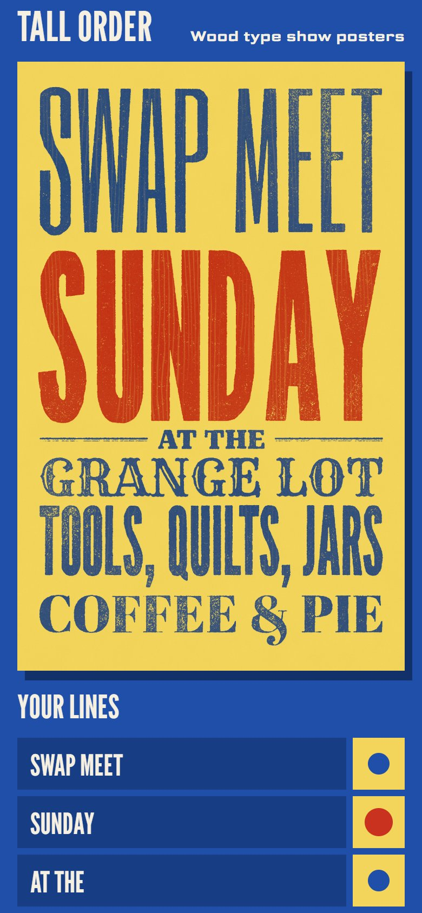

# Tall Order

Type a few lines and a wood type show poster sets itself, then pull it.

**[Try it](https://michaelshadpour.com/try/tall-order)** and read [the write-up](https://michaelshadpour.com/work/tall-order).




## What it is

Tall Order is a fictional letterpress shop that prints show posters from wood type. You type a few lines and the poster sets itself the way the old ones were set: every line in whatever face, width and size makes it reach both edges of the sheet, and the stack fills the sheet top to bottom. Then you pull the print: the forme is inked, the sheet comes down and lifts, and you hold a print with the salty, uneven ink of real wood type, which you can save as a PNG.

What to try:

- Type your own lines, up to eight. The poster sets itself again on every letter.
- Tap a line on the poster, or the dot beside it in the list, to print that line in the second ink.
- Pick a paper stock and a pair of inks, and press **Shuffle the faces** for another setting of the same lines.
- Press **Pull the print**. After that, **Save the print** gives you a PNG of 1400 by 2200 pixels (on a phone it opens the share sheet where the browser can share files), **Pull another** presses the same forme again with a new seed, and **Change the type** goes back to the lines.

Below the press, the page explains how a show poster is set and lists the shop's sizes and prices. The shop, the prices and the events on the starter posters are invented.

Adding `?attract=1` to the address starts a self-running demo mode. It opens on a finished print, then a poster types itself line by line, the faces shuffle once, the print is pulled, and the next poster starts. It hands over on the first touch, click, key press or turn of the mouse wheel.

## How it works

- **The type engine is real and runs the same in Node and in the browser.** Every line fills the measure by choosing a face, a width on its width axis and a size, never by stretching glyphs or spacing letters. Line width is measured from the actual glyph outlines (left edge of the first letter's ink to the right edge of the last, kerning included) at the exact axis value, and the size is then the measure divided by that width, so each line meets both margins exactly. The unit tests load the real font files and check that every line lands within 0.01 inch (one print pixel) of both margins.
- **The stack fills the sheet by trading height through width.** A condensed setting is taller, an extended one shorter. Each line's height is sampled across its width axis and the solver finds one scale that makes the whole stack meet both margins (bisection on a water-filling problem), with role caps for hierarchy that relax step by step so the sheet fills with type before space opens up. Connector words ("and", "at the", "with") become small catch lines flanked by thick-and-thin rules. A line too short to fill without towering gets rules too, and spare space goes to brass rules between lines.
- **Faces are cast like a compositor would.** There are eight faces, from condensed gothics to an extended slab, a fat face and one decorated face. A shuffle samples 36 seeded assignments, scores them (fill, one or two dominant lines, no neighbors in the same face, the decorated face at most once and never the headliner), then improves the best one line at a time. While you type, every other line keeps its face. The line being typed may move only when another face is clearly better, and when lines are added or removed all lines get that chance. The same lines and seed always give the same poster.
- **The print is pressed in a shader, from one seed.** The forme is drawn as an ink mask at 100 pixels per inch (1400 by 2200), one channel per ink pass plus how much wood grain each line shows, with per-letter wobble and the second pass shifted and turned a hair out of register. A WebGL pass then lays ink with uneven platen pressure, salt that gathers where pressure is light and in big flat areas, a denser squeezed rim at letter edges, chipped corners from a wandering edge threshold, faint grain in the largest letters, paper tooth and a light bite of the type into the sheet. Ink color is worked out in linear light, as a mix of a subtractive film that the paper shows through and an opaque layer. The saved PNG is the full-size canvas that the print on screen was drawn from.
- **One clock drives everything that moves.** It sleeps when nothing moves and when the tab is hidden. While you type, widths and positions glide toward the new setting, and every in-between frame still fills the measure, because each frame measures the line again at its current width.

### Why the type is drawn from outlines

Canvas 2D cannot set an arbitrary value on a font's width axis directly. Before the engine was written, three ways around that were compared in Chromium, setting "GRANGE HALL" in Science Gothic at 80 px at widths 50, 87.3 and 163.7. The code for that comparison is not in this repository.

| Way | Result in Chromium |
|---|---|
| Glyph outlines instanced in JavaScript (fontkit), drawn as `Path2D` | Exact by construction: the numbers are pure JavaScript and the browser only fills paths |
| One registered `FontFace` per instance (stretch pinned) and `fillText` | Applies the axis, but measures 0.36 px and 0.84 px off the outline math at 80 px (about 4 to 10 px at poster sizes) |
| One variable `FontFace` and `ctx.fontStretch` | Only the nine keyword widths exist (semi-condensed is 87.5, not 87.3) |

The outline approach was chosen because it takes the browser's font stack out of measuring, drawing and exporting entirely. The same code produces identical layouts in Node (the unit tests) and in the page, and the only browser steps are filling paths and running one WebGL shader. The page relies only on `Path2D` from SVG path data, canvas `fillRect`, `toBlob`, and WebGL 1 with high-precision fragment floats. Where that WebGL support is missing, the print falls back to a flat 2D one.

### Measured during development

These figures were measured while the project was being built. Nothing in the tests checks them.

- First load: about 522 KB transferred (HTML 1.7 KB gzip, CSS 2.5 KB gzip, JS 149.1 KB gzip, eight woff2 fonts 368 KB).
- At 390 x 844, device pixel ratio 3, CPU throttled 4 times (`npm run perf`, headless Chromium, desktop GPU):
  - Re-setting the poster per keystroke: median 17.6 ms, p95 30.4 ms (a second run gave 15.9 and 23.2). Redrawing the proof: median 1.2 ms, p95 1.7 ms.
  - Frame interval while typing with the keyboard: median 16.7 ms, p95 16.8 ms.
  - Tap to the first frame of the pull, including pressing the print: 58 ms (42 ms in an earlier run). Frame interval during the pull: median 16.7 ms, p95 16.7 ms.

### Known limits

- Only Chromium was tested. Playwright's WebKit and Firefox builds could not be started on the development machine, so Safari (including on iPhone) and Firefox are untested, and the comparison above ran in Chromium only. This is the biggest open risk.
- Frame times come from headless Chromium with a desktop GPU and a throttled CPU, not from a real phone. Pressing the print uses a 1400 by 2200 WebGL pass that has not been timed on a low-end phone GPU.
- The phone editing view (poster on top, lines below, sized to the visible viewport) was checked by shrinking the viewport, not with a real on-screen keyboard.
- When the lines are too long for type alone to fill a 14 by 22 sheet, the extra space gets brass rules instead, as a compositor would set it. A single line or a single letter is centered with rules or stars.
- Only Latin type is in the case. Characters no face has (emoji, other scripts) are left off the poster.
- Saving through the share sheet on phones depends on the browser supporting file sharing. Otherwise the print downloads. Neither was tried on a real phone.

## Stack

- Vite 6 and TypeScript (strict), no framework.
- fontkit 3 (the core build with only the WOFF2 reader) to read the type case and instance width-axis outlines in JavaScript.
- Canvas 2D for the live proof and the forme, WebGL 1 for pressing the print.
- Fonts are self-hosted through Fontsource. The page loads its own files and makes no requests to other hosts.
- Vitest for the unit tests, which run in Node with the real font files, and Playwright for the end-to-end tests.

## Run it

```
npm install
npm run dev        # http://127.0.0.1:5313
npm test           # unit tests: fitting, stacking, faces, edge cases, typing stability
npm run build      # type check, then build the static site into dist/
npm run preview    # serves the project folder; open http://127.0.0.1:5413/dist/
```

The dev server is pinned to port 5313 and stops with an error if that port is taken.

End-to-end tests, run at phone size with touch and at desktop size:

```
npx playwright install chromium
npm run test:e2e   # builds first, then runs Playwright against dist/
```

The end-to-end run starts its own static server on port 5413, so stop `npm run preview` before you run it.

Timings, which need a build and the Chromium installed above:

```
npm run build
npm run perf       # 390 x 844 with 4x CPU throttling
```

There are 21 unit tests in `tests/` and 8 end-to-end tests in `e2e/`. The PNG download test is skipped at phone size, because phones use the share sheet.

The Playwright config and the perf script start Chromium with `--use-angle=d3d11`, which is a Windows (Direct3D 11) setting. On macOS or Linux you may need to change or remove that flag.

Three address parameters exist for demos and tests. `?attract=1` starts the self-running demo mode. `?capture=1` stops the real-time clock, which then only advances when `window.__step(ms)` is called. `?flat=1` forces the print made without WebGL.

## Layout

- `index.html`: the page, with the press, the line editor and the reading sections.
- `src/main.ts`: the app. State, the live proof, the pull animation, saving and the line editor.
- `src/engine/`: the type engine. `setter.ts` is the compositor (fitting, the stack solver and face assignment), `typecase.ts` measures lines from glyph outlines, `faces.ts` and `fontfiles.ts` describe the eight faces, and `rng.ts` is the seeded random source.
- `src/press/`: `shapes.ts` turns a set poster into glyphs, rules and stars, and `print.ts` draws the ink mask and presses the print in WebGL.
- `src/attract.ts`, `src/clock.ts`, `src/fonts.ts`, `src/posters.ts`: the self-running demo, the clock, font loading in the browser, and the starter posters, paper stocks and inks.
- `tests/`: unit tests for the type engine. `node-case.ts` loads the font files in Node.
- `e2e/`: Playwright tests. `frame.html` hosts the built page in a frame for one of them.
- `scripts/`: `serve.mjs` is the static server behind `npm run preview` and the end-to-end tests. `perf.mjs` and `browser.mjs` take the timings.
- `docs/`: the screenshots in this README.

## Credits and license

Fonts, all self-hosted from Fontsource, Latin subset only:

- Science Gothic (variable, width and weight axes), League Gothic (variable, width axis), Roboto Serif (variable, width and weight axes): SIL Open Font License 1.1, `@fontsource-variable/*`.
- Six Caps, Abril Fatface, Holtwood One SC, Rye: SIL Open Font License 1.1, `@fontsource/*`.
- Ultra: Apache License 2.0, `@fontsource/ultra`.

fontkit is under the MIT license.

There are no photographs or other pictures. Everything else is drawn in code: the poster, rules and stars, the forme, the roller, the print texture and the favicon.

Concept project. Tall Order is a fictional brand.

Design and build: [Michael Shadpour](https://michaelshadpour.com).

The code is under the MIT license. See [LICENSE](LICENSE).
